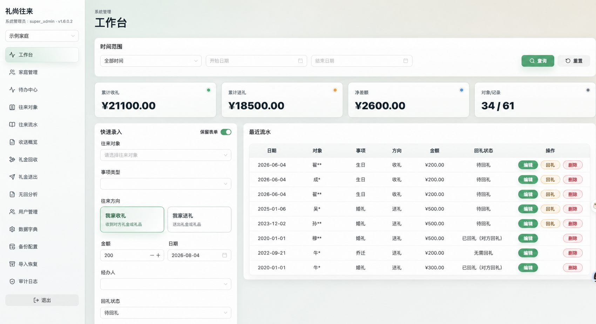
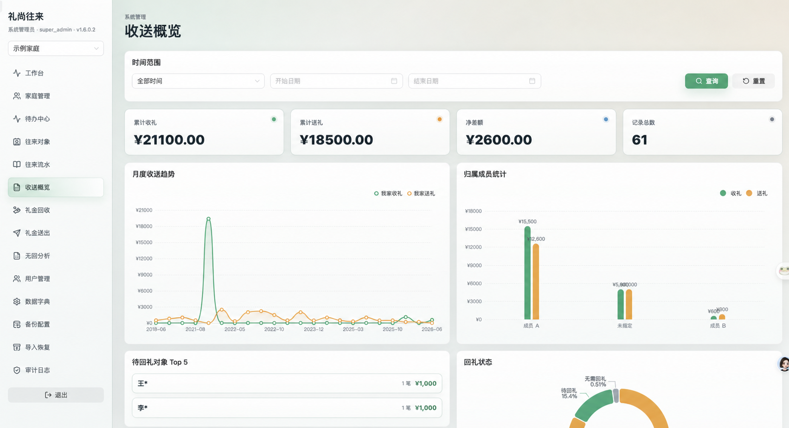

# 礼尚往来 (Gift Ledger)

<p align="center">
  A self-hosted, family-oriented ledger for recording gifts, cash gifts, relationships, reciprocity, and the stories behind them.
</p>

<p align="center">
  <a href="README.md">English</a> · <a href="README_zh-CN.md">简体中文</a>
</p>

<p align="center">
  
  
  
  
  <a href="LICENSE"></a>
</p>

Gift Ledger helps a household keep a reliable record of gifts received and given. It combines fast entry, contact and relationship management, reciprocity tracking, analytics, Excel backup and restore, tenant isolation, and lightweight auditing in one responsive web application.

> The interface is currently Chinese. This repository provides English and Simplified Chinese documentation.

## Screenshots

All names and household identifiers shown below have been anonymized.

### Dashboard and quick entry



### Analytics overview



## Highlights

- **Family tenant isolation** — every household owns an isolated data scope; business queries derive `family_id` from the authenticated session.
- **Three fixed roles** — `super_admin`, `family_admin`, and `member`, with role-aware menus, routes, and API authorization.
- **Fast gift entry** — record incoming or outgoing cash and gifts, event type, date, handler, notes, and reciprocity status.
- **People and relationships** — manage contacts independently from user accounts and classify them with household or system dictionaries.
- **Reciprocity workflows** — track pending, completed, linked, and no-reciprocity records without opaque automatic matching.
- **Practical analytics** — dashboards for totals, trends, member ownership, relationships, events, pending reciprocity, and non-reciprocal records.
- **Recoverable backups** — export complete household workbooks, send scheduled email backups, optionally encrypt ZIP attachments, and merge-import a backup.
- **Operational safeguards** — access/refresh sessions, forced first-login password changes, login throttling, structured logs, soft deletion, and audit retention.

## Technology

| Layer | Stack |
| --- | --- |
| Backend | Go, Gin, GORM, Swagger |
| Frontend | Vue 3, Vite, Naive UI, ECharts |
| Database | PostgreSQL |
| Data portability | Excel import/export, optional encrypted ZIP |
| Deployment | Docker Compose or separate frontend/backend processes |

```text
Browser
  └─ Vue 3 SPA
       └─ REST API (Go + Gin)
            ├─ PostgreSQL
            ├─ in-process backup/session/audit scheduler
            └─ SMTP server for scheduled and pre-import backups
```

## Quick start with Docker

### Requirements

- Docker 24 or later
- Docker Compose v2

```bash
git clone https://github.com/Zorabi/ledger-project.git
cd ledger-project
docker compose up -d --build
```

After the containers are healthy:

| Service | URL |
| --- | --- |
| Web application | <http://localhost> |
| Backend API | <http://localhost:8080> |
| Swagger UI | <http://localhost:8080/swagger/index.html> |
| PostgreSQL | `127.0.0.1:5432/ledger` |

The development bootstrap account is `admin` / `ChangeMe123!`. Change this password immediately. The default Docker and YAML credentials are intended only for local evaluation and must not be used in production.

Useful commands:

```bash
docker compose ps
docker compose logs -f
docker compose down
```

## Local development

### Requirements

- Go 1.24+
- Node.js 20+ and npm
- PostgreSQL 16+, or Docker for the database

Start PostgreSQL, then run the backend and frontend in separate terminals:

```bash
docker compose up -d postgres
make dev-backend
make dev-frontend
```

The Vite development server is available at <http://localhost:5173>.

Run the project checks:

```bash
make test
```

Build release artifacts for the current platform:

```bash
make build
```

Run `make help` for cross-platform backend builds, frontend packaging, SQL migration, database backup, and restore commands.

## Configuration

Backend configuration is loaded from `backend/config.yaml` and can be overridden with environment variables. Use `.env.example` as a reference; never commit a populated production configuration.

| Variable | Purpose |
| --- | --- |
| `DATABASE_POSTGRES_*` | PostgreSQL connection and automatic create/migrate settings |
| `JWT_SECRET` | Token signing secret; use a long random value in production |
| `APP_ENCRYPTION_KEY` | Master key used to protect encrypted backup ZIP passwords |
| `APP_VERSION` | Displayed application version |
| `EMAIL_*` | SMTP server used for backup delivery |
| `AUDIT_RETENTION_DAYS` | Audit retention policy: `30`, `60`, or `90` days |
| `LOG_*` | Structured console/file logging and rotation settings |

Production deployments must replace all sample passwords and secrets, disable automatic database creation/migration when migrations are controlled manually, use TLS where appropriate, and preserve `APP_ENCRYPTION_KEY` during server migration.

## Backup and restore safety

- A backup is a complete Excel workbook for one household.
- Scheduled backups can be delivered by email, optionally inside an encrypted ZIP.
- Restore uses merge import; it does not clear the household first.
- Before a formal import, the system must email a current household backup. If that email fails, the import is aborted.
- Imported files and email attachments may contain sensitive personal and financial data. Store and transmit them accordingly.

## Documentation

- [Simplified Chinese README](README_zh-CN.md)
- [Product requirements](docs/product-requirements.md) (Chinese)
- [Architecture](docs/architecture.md) (Chinese)
- [Database migration guide](sql/README.md) (Chinese)
- [Changelog](CHANGELOG.md)
- [Contributing guide](CONTRIBUTING.md)
- [Security policy](SECURITY.md)

## Contributing

Issues and pull requests are welcome. Please read [CONTRIBUTING.md](CONTRIBUTING.md) before submitting a change. Keep tenant isolation, authorization, audit logging, API compatibility, and responsive behavior in scope when modifying business features.

## License

Copyright © 2026 Gift Ledger contributors.

This project is licensed under the [GNU Affero General Public License v3.0](LICENSE). If you modify the software and make it available to users over a network, the AGPL requires that those users be offered the corresponding source code. See the license text for the complete terms.
